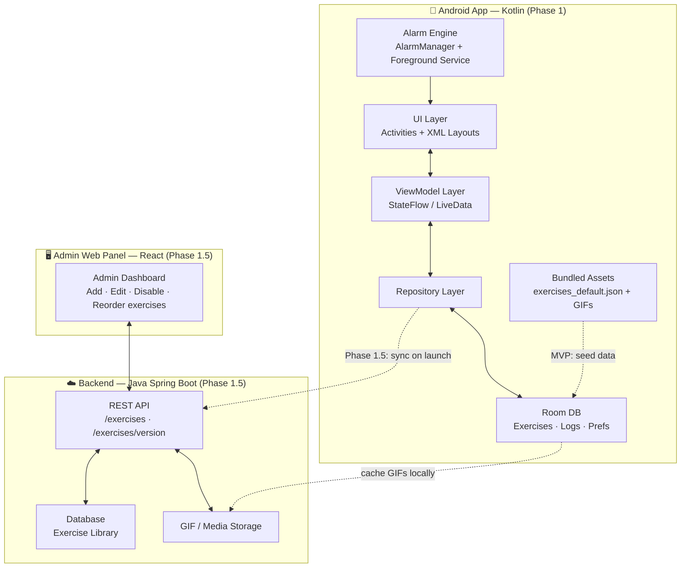
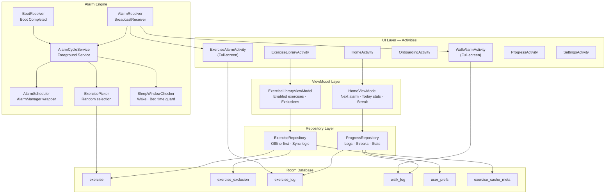
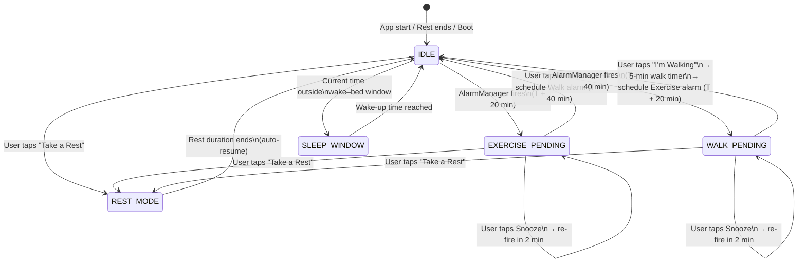
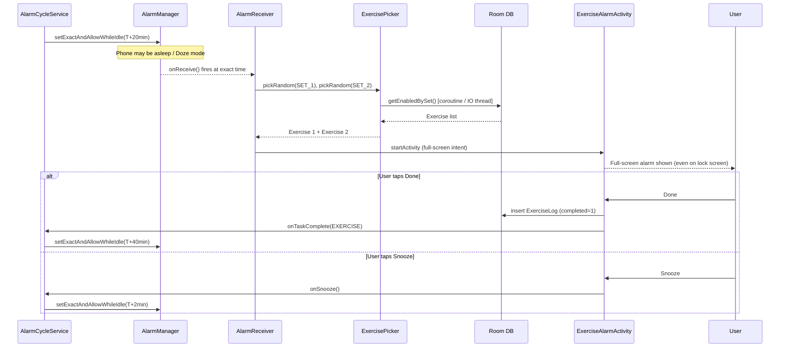
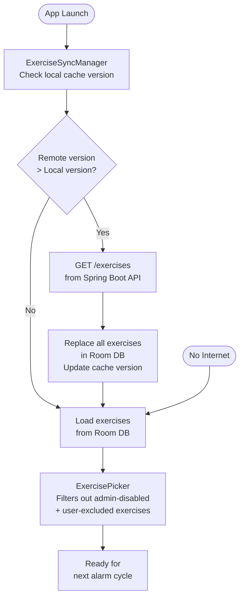

# BackHealth — Architecture Diagrams

---

## 1. Overall System Architecture (All Phases)



---

## 2. Android App — Internal Layer Architecture (MVVM)



---

## 3. Alarm Cycle State Machine



---

## 4. Alarm Engine — Trigger & Delivery Flow



---

## 5. Exercise Sync Flow — Offline-First (Phase 1.5)



---

## 6. Rest Mode & Sleep Window Flow

```mermaid
flowchart TD
    USER([User]) -->|Taps "Take a Rest"| BOTTOM["Bottom Sheet\n20 min · 30 min · 40 min\n1 hr · 1.5 hr · Custom"]
    BOTTOM --> CANCEL["Cancel all\npending AlarmManager alarms"]
    CANCEL --> NOTIFY["Show persistent notification\n'Resting — resumes in X min'"]
    NOTIFY --> TIMER["Schedule rest-end alarm\nvia AlarmManager"]
    TIMER --> RESTEND([Rest duration ends])
    RESTEND --> RESUME["Restart AlarmCycleService\nState → IDLE\nSchedule T+20min exercise alarm"]

    SCHED([Every alarm about to fire]) --> SLEEPCHECK{"Current time\ninside wake–bed\nwindow?"}
    SLEEPCHECK -- Yes --> FIRE["Fire alarm normally"]
    SLEEPCHECK -- No --> SKIP["Skip alarm silently\nReschedule for next\nvalid window"]
```
